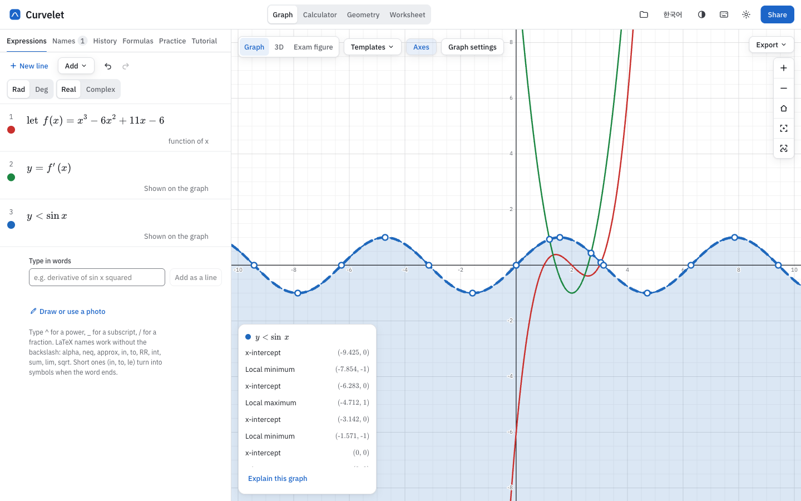

# Curvelet

A graphing calculator, symbolic calculator and geometry board that works offline. You type math the way you write it, and graphs, exact answers and figures update as you go.



**Download:** installers for macOS, Windows and Linux are on the [releases page](https://github.com/aylynuw/curvelet/releases). The desktop app updates itself; if you have 0.2.0, install the next version by hand once. The macOS and Windows builds aren't code-signed yet, so the first launch shows a warning.

## What it does

- **Graph:** functions, equations and inequalities, parametric and polar curves, sliders, points you can drag, tables with regression, images under the graph, a pen for drawing curves, and an exam-figure mode that exports to SVG, PNG, PDF and TikZ
- **Calculator:** exact answers (fractions, roots, π), derivatives, integrals with + C, limits, equation solving, matrices; definitions kept on the tape and shared with the graph
- **Geometry:** points, segments, circles, constructions, measured lengths and angles, shape colours, images, and sending a figure to the graph
- **Study:** practice problems and printable worksheets
- **Projects:** everything above saved together in the browser, or exported as a `.curvelet` file

Symbolic math runs on SymPy inside the browser ([Pyodide](https://pyodide.org)), so nothing is sent to a server.

## How it was made

I built Curvelet with [Claude Code](https://claude.com/claude-code), Anthropic's coding agent, which wrote the code. My part was the product: what goes in and what stays out, the design direction, and checking that it works. I tried each change in the app, sent back what was wrong, and decided when it was done. The tests (846 of them, including round trips for every math symbol the input understands) exist because I asked for each behaviour to be pinned down.

I'm now using this codebase to learn to read and write code myself, one module at a time.

## Running it

Needs Node 24.

```bash
npm ci
```

```bash
npm run dev
```

That opens the web app at http://localhost:5173. The first run copies Pyodide into `packages/cas/pyodide-dist` and downloads the SymPy wheels once, checked against their published hashes.

```bash
npm test
```

```bash
npm run typecheck
```

The desktop app is a [Tauri](https://tauri.app) shell around the same web app; building it needs Rust. See [docs/apps.md](docs/apps.md) for the desktop and mobile builds and how releases and updates work.

## Layout

| Folder | What's in it |
|---|---|
| `packages/engine` | Parsing, evaluation, definitions and the workspace every tool shares |
| `packages/cas` | The SymPy bridge running in a web worker |
| `packages/input` | Typed math to LaTeX and back |
| `packages/render` | Turning a graph into a scene, and drawing it to canvas, SVG, PDF and TikZ |
| `packages/steps` | Worked steps for derivatives and equations, and the practice problems and mock exams |
| `apps/web` | The app itself (React, Vite, MathLive) |
| `apps/desktop` | The Tauri desktop app |
| `apps/mobile` | A Capacitor shell for iOS and Android (not released) |

[PLAN.md](PLAN.md) has the feature list, what's been built and what comes next.

## Code signing policy

The Windows installers are to be signed with free code signing provided by [SignPath.io](https://about.signpath.io), certificate by [SignPath Foundation](https://signpath.org). The application is under review; until it is approved the installers are unsigned, and Windows shows a SmartScreen warning (choose "More info", then "Run anyway").

- Committers and reviewers: [aylynuw](https://github.com/aylynuw), the only maintainer
- Approvers: [aylynuw](https://github.com/aylynuw), who approves each release by hand before it is signed
- Only installers built by this repository's GitHub Actions workflow from its own source are signed

Privacy: the desktop app sends nothing about your work anywhere. Its only network request is a check for a newer version on this repository's releases page, a few seconds after it starts. See the [privacy policy](docs/store/privacy.md).

## License

The code is under the [MIT License](LICENSE).

The name "Curvelet" and its logo are mine and aren't covered by that license. If you publish a fork or something built from this code, please give it a different name.

---

## 한국어 요약

Curvelet은 인터넷 없이 쓰는 그래프 계산기, 기호 계산기, 기하 도구입니다. 설치 파일은 [릴리스 페이지](https://github.com/aylynuw/curvelet/releases)에 있고, 데스크톱 앱은 스스로 업데이트합니다(0.2.0을 쓰고 있다면 다음 버전만 한 번 직접 설치해 주세요).

코드는 Claude Code가 작성했고, 기능 범위와 디자인 방향을 정하고 앱에서 직접 써 보며 검증한 것은 제가 했습니다. Windows 설치 파일은 SignPath Foundation의 무료 코드 서명을 신청해 둔 상태이고, 승인 전까지는 서명이 없어 SmartScreen 경고가 뜹니다("추가 정보" → "실행"). 코드는 MIT 라이선스로 누구나 쓸 수 있지만, "Curvelet"이라는 이름과 로고는 제 것이라 라이선스에 포함되지 않습니다.
